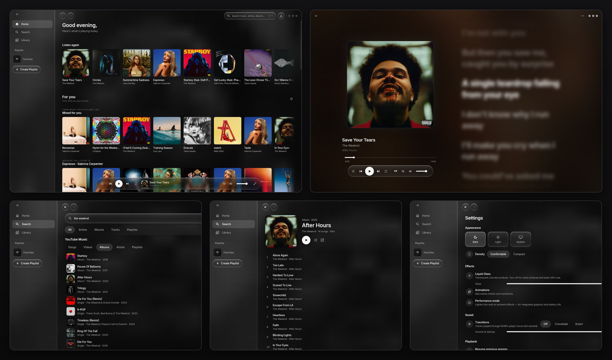
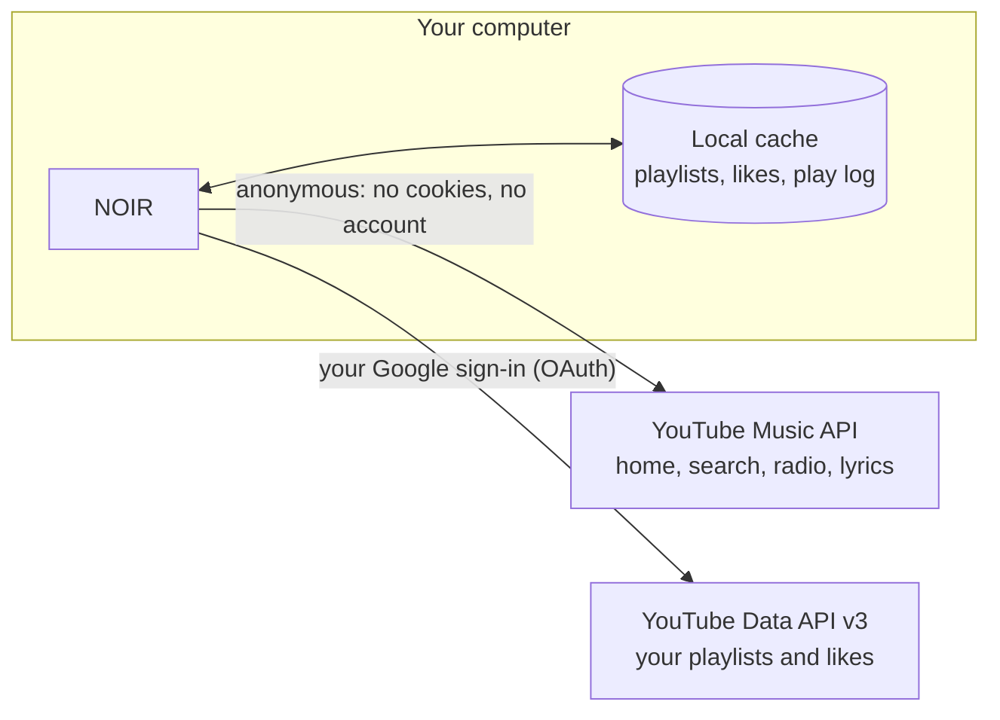

# NOIR

**Less interface. More music.**

YouTube Music has no desktop app. What Google offers on Windows is the
website in a window: it takes a while to start, stutters when you scroll a
long playlist, and eats memory like a browser tab, because that's what it is.

NOIR is a desktop client for YouTube Music. It isn't a separate music
service and has no catalog of its own: under the hood it talks to YouTube
Music's API, the same one music.youtube.com uses, and to the official
YouTube Data API for your account. What changes is the app around it: a
native interface that answers the moment you click, built for a computer
rather than a browser tab. It also plays your own audio files.



<sub>Screenshots from the Windows build. Lyrics are blurred in the image on
purpose.</sub>

## Why NOIR

- It's a native app, not a browser tab. Long playlists scroll smoothly, and
  your playlists and likes are cached on disk, so they show up instantly.
- The interface is quiet: black and white, big artwork, nothing in the way
  of the music.
- The music is the YouTube Music you already have: same catalog, your
  playlists and likes, radio and search. NOIR adds what the site lacks, such
  as smooth transitions between songs and local files in the same library.

## What it does

Home opens with **Listen again** (what you play most, YouTube only), your
pinned playlists, and **For you**: mixes built from radio seeded by your own
plays, likes and playlists. Below that sits YouTube Music's regular home feed
with its mood chips.

Search goes to YouTube Music (songs, videos, albums, artists, playlists) and
to your local library at the same time. Albums, artists and playlists open as
pages inside the app.

Now Playing shows big artwork over a slowly moving, blurred copy of it. Time
synced lyrics appear next to the cover, line by line or word by word
(karaoke). Lyrics come from YouTube Music, with LRCLIB as a fallback. Click
the cover to pause.

The queue never runs dry: when fewer than five tracks are left, NOIR appends
more of the same YouTube Music radio. If YouTube Music only has a song as a
music video (with intro and skits), NOIR swaps in the plain studio track,
like YouTube Music does in song mode.

Between tracks NOIR can do a plain crossfade or a "smart" transition that
picks the moment and the type of blend for each pair of songs. Both work on
tracks played through NOIR's own audio player.

Connect a Google account and NOIR syncs your YouTube playlists and liked
music both ways. Adding a song to a playlist or removing it in NOIR changes
the playlist on YouTube. The heart saves to a playlist you choose, or to
Liked music, which likes the song on YouTube.

The rest:

- Local files: MP3, M4A/AAC, FLAC, OGG, Opus and WAV, with tags and cover art.
- Liquid Glass surfaces you can turn off, plus a performance mode for laptops
  with integrated graphics.
- Windows media keys and the Windows media flyout work while the window is
  in the background.
- Dark, light and system themes; comfortable and compact density.

## How NOIR talks to YouTube Music



YouTube Music has no public API for its catalog, home feed or radio. NOIR
uses the API that the music.youtube.com website itself calls, and it calls it
**without your account**: no cookies, no login, no tokens. A guard in the
network layer strips any of them before a request leaves the app.

That is deliberate, and it is about your account's safety. Signing in to
that API from a third-party app means handing the app your browser session,
which YouTube's Terms of Service don't allow. Google also watches for
logged-in sessions driven by software that isn't a browser, and an account
caught that way can be asked to verify itself, restricted or suspended. With
anonymous requests the worst case is that YouTube slows down or blocks NOIR
itself; your Google account is never part of it. The price is that the home
feed is the same for everyone, which is why NOIR builds **For you** on your
own computer from what you play, like and save.

Your account goes through one door only: the official YouTube Data API, with
a normal Google sign-in in your browser (OAuth). That is the route Google
offers to apps. It covers your playlists and likes, asks for those
permissions by name, and you can revoke it any time at
[myaccount.google.com/permissions](https://myaccount.google.com/permissions).
The refresh token is kept in the Windows Credential Manager.

Recommendations, the play log and the cache stay on your computer. Settings
has a button that clears the listening history. Details:
[docs/privacy.md](docs/privacy.md).

## How the code is organized

```
lib/
  app/            bootstrap, router, adaptive shell, theme and glass
  core/           database, window chrome, shared widgets
  features/       one folder per feature
    home, discover, search, library, playlists, playback, queue,
    lyrics, youtube, accounts, settings, …
      data/          repositories (Drift)
      domain/        models and interfaces
      application/   Riverpod controllers and providers
      presentation/  screens and widgets
  integrations/
    youtube_music/   anonymous YouTube Music client and parsers
    youtube_data/    YouTube Data API v3 (playlists, likes)
    google_auth/     OAuth 2.0 with PKCE through the system browser
    youtube_playback/ official IFrame player in WebView2
    local_audio/     just_audio + media_kit (libmpv)
    lyrics/          YouTube Music and LRCLIB sources
  shared/         Track, Playlist, PlaybackState and other models
```

State lives in Riverpod 3 providers, without code generation. Anything that
does I/O is a provider, which lets tests swap in fakes for the database, the
audio engine and the network clients.

Playback has a single owner:

```
UI ── commands ──▶ PlaybackController   (queue, shuffle, repeat, radio, session)
                         │
                         ▼
                   PlaybackEngine        (local audio player, or the YouTube embed)
                         │  status, position, completion
                         ▼
                   PlaybackState ──▶ mini player, Now Playing, queue, Windows SMTC
```

Each engine reports what it can do (seek, crossfade, play in the background).
The UI hides controls an engine doesn't support instead of greying them out.

Data is stored in SQLite through Drift (schema v4): the local library,
playlists, play history, cached YouTube playlists and likes, and settings as
JSON documents. Every schema version is snapshotted in `drift_schemas/` and
covered by a migration test.

YouTube sync works in two directions. Pulling compares ETags so unchanged
playlists cost almost nothing. Edits made in NOIR show up locally right
away, go out to the Data API, and are kept on top of YouTube's answers for a
couple of minutes, because YouTube keeps returning the old list for a while
after a write.

## Platforms

| Platform | State |
|---|---|
| Windows | Available. Debug and release builds tested |
| Android | Planned |
| macOS | Planned |
| iOS | Planned |

What is missing on purpose, and why: [docs/limitations.md](docs/limitations.md).
How YouTube fits in: [docs/youtube-capability-matrix.md](docs/youtube-capability-matrix.md).

Inter is © The Inter Project Authors, SIL Open Font License 1.1
(`assets/fonts/Inter-LICENSE.txt`).
