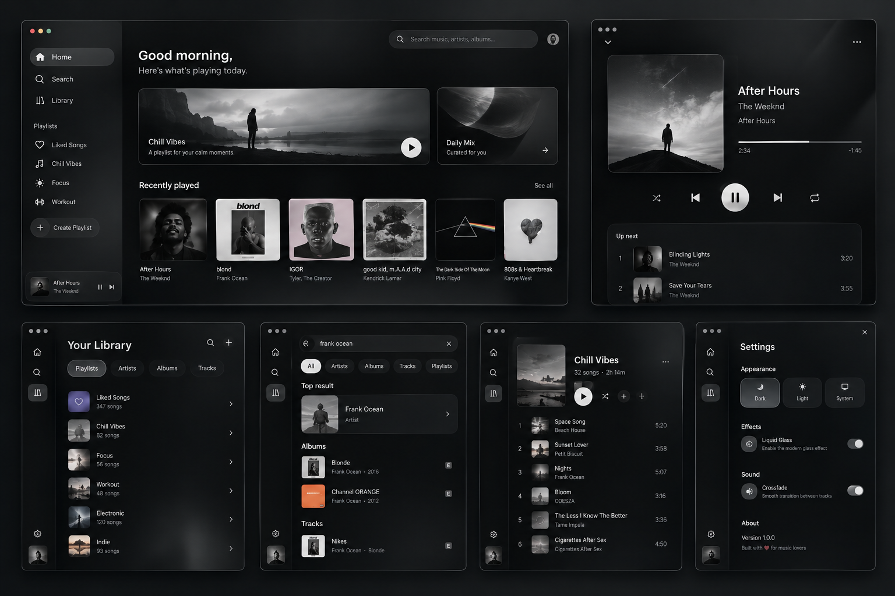

# NOIR

**Less interface. More music.**

NOIR is a minimalist, monochrome music player with optional Liquid Glass
surfaces. Windows is the primary target; the same Flutter codebase also builds
for Android, macOS and iOS.



## Status (first iteration)

| Area | State |
|---|---|
| Local library (folders, files, tags, artwork) | Working |
| Local playback (queue, shuffle, repeat, seek, volume, crossfade, resume) | Working |
| Screens: Home, Search, Library, Album/Artist/Favorites, Playlists, Now Playing, Queue, Settings | Working |
| Liquid Glass / Animations / Performance mode switches | Working, live, persisted |
| Google / YouTube account | **Not yet** — interfaces, capability audit and embed spike only (Phase 5) |

See [docs/limitations.md](docs/limitations.md) for everything that is
deliberately not there and why.

## Quick start (Windows)

```powershell
flutter pub get
dart run build_runner build
flutter run -d windows
```

Toolchain details, Android SDK notes and build commands:
[docs/setup.md](docs/setup.md).

## Tests

```powershell
flutter analyze
flutter test                                   # unit + widget tests
flutter test integration_test -d windows       # real engine: playback, effects, layouts
```

The integration tour accepts `--dart-define=NOIR_DEMO_DIR=<music folder>` and
`--dart-define=NOIR_SHOT_DIR=<folder>` to save a screenshot of every screen.

## Documentation

- [Architecture](docs/architecture.md)
- [YouTube capability matrix](docs/youtube-capability-matrix.md) and the
  [WebView2 embed spike](docs/spikes/yt-embed.md)
- [OAuth flow (planned)](docs/oauth-flow.md)
- [Privacy](docs/privacy.md)
- [Limitations](docs/limitations.md)
- [Design reference and deviations](docs/design/README.md)

Inter is © The Inter Project Authors, SIL Open Font License 1.1
(`assets/fonts/Inter-LICENSE.txt`).
